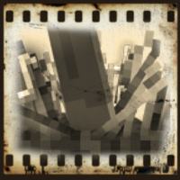

# Past Footsteps

A Forge 1.7.10 port of [Presence Footsteps](https://github.com/Sollace/Presence-Footsteps): material footsteps, foliage rustling, equipment accents and footprints for players and mobs.



[](https://github.com/AngelicIndustries/PastFootsteps/releases)
[](https://67minecraft.com/mod/c09YLjZ1)

[](https://discord.gg/xAWCqGrguG)

<!-- Not published yet
[](https://www.curseforge.com/minecraft/mc-mods/pastfootsteps)
[](https://modrinth.com/mod/pastfootsteps)
[](https://www.mcmod.cn/class/PROJECT_ID.html)
[](https://maven.angelic.industries/#/releases/industries/angelic/pastfootsteps/PastFootsteps)
-->

## Features

* Steps by block material, with running, jumping, landing, wading and swimming sounds
* Foliage rustling, equipment and rain accents, and [footprints](docs/Footprints.md)
* Players and supported mobs, including spiders on walls, set up with [entity and gait profiles](docs/Resource-packs.md#entity-and-gait-profiles) and [equipment](docs/Equipment.md)
* Other players and mobs are heard where they walk; unmatched creatures keep their own sounds
* Takes over Dynamic Surroundings' footsteps while enabled
* Works on any server, with [optional server support](docs/Server-support.md)
* [Configurable](docs/Configuration.md) from the mod list, with an [API](docs/Integration.md) for other mods

Walking features formerly in An Extra Touch now belong here; see the [migration guide](docs/AET-migration.md).

## Dependencies

* [UniMixins](https://modrinth.com/mod/unimixins) [](https://www.curseforge.com/minecraft/mc-mods/unimixins) [](https://modrinth.com/mod/unimixins/versions) [](https://github.com/LegacyModdingMC/UniMixins/releases)

## Building

```sh
./gradlew build
```

## Credits

* Hurricaaane, Sollace and the [Presence Footsteps contributors](https://github.com/Sollace/Presence-Footsteps)
* [GT:NH buildscript](https://github.com/GTNewHorizons/ExampleMod1.7.10)

## License

The code is [MIT-licensed](LICENSE), derived from [MIT-licensed code](https://github.com/Sollace/Presence-Footsteps/blob/d0d860591287656244e7236a9131004d1d0ddee6/LICENSE).

## Buy me some creatine

* [ko-fi.com](https://ko-fi.com/jackisasubtlejoke)
* Monero: `893tQ56jWt7czBsqAGPq8J5BDnYVCg2tvKpvwTcMY1LS79iDabopdxoUzNLEZtRTH4ewAcKLJ4DM4V41fvrJGHgeKArxwmJ`
